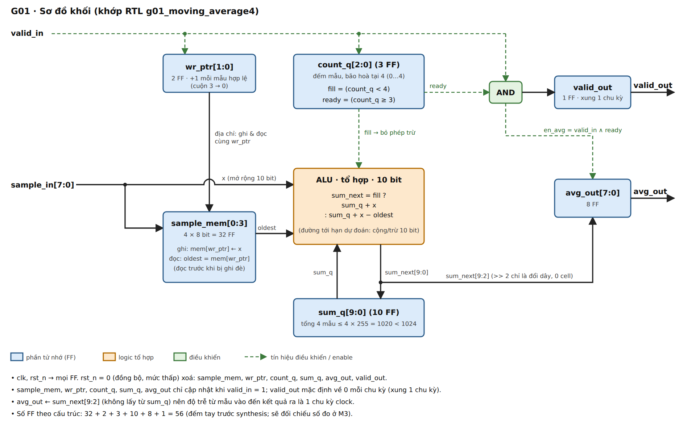
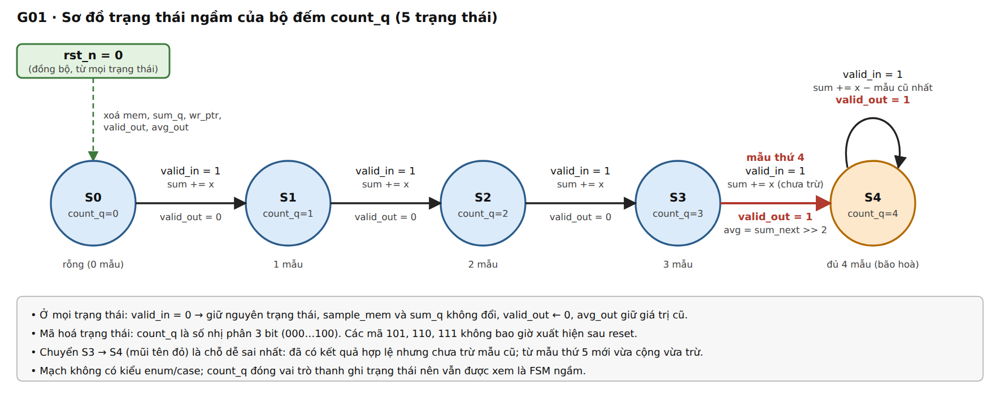
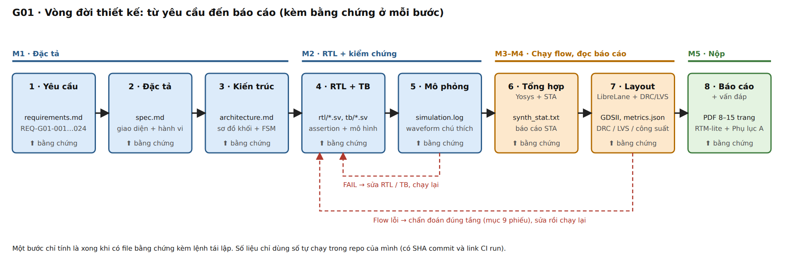

# G01 · Kiến trúc hệ thống

**Phiên bản:** M1 (hoàn thiện lần 1). Các sơ đồ nằm trong `diagrams/` (cả `.svg` và `.png`). Sơ đồ khối được vẽ để khớp RTL: nguồn của `avg_out` là `sum_next`, không phải `sum_q`.

---

## 1. Vị trí trong hệ thống

G01 là lõi số giữa ADC 8 bit và mạch hiển thị, chạy hoàn toàn trong miền thời gian rời rạc. Về mặt toán học nó là bộ lọc FIR bốn hệ số bằng nhau (1/4).

```text
┌──────────┐    ┌─────────┐    ┏━━━━━━━━━━━━━━━━━━━━━━━━━━━┓    ┌───────────────┐
│ Cảm biến │ mV │   ADC   │ 8b ┃   LÕI G01 (RTL)           ┃ 8b │ Giải mã &     │
│ nhiệt độ │───▶│ (8 bit) │───▶┃   Trung bình trượt 4 điểm ┃───▶│ hiển thị LED  │
└──────────┘    └─────────┘    ┗━━━━━━━━━━━━━━━━━━━━━━━━━━━┛    └───────────────┘
```

---

## 2. Sơ đồ khối và đường dữ liệu



Kiến trúc dùng **bộ đệm vòng** (circular buffer) lưu 4 mẫu và **bộ tích luỹ trượt** (sliding accumulator): mỗi mẫu mới chỉ cộng mẫu mới và trừ mẫu cũ nhất vào tổng đang có, thay vì cộng lại cả 4 mẫu.

**Đường đi của một mẫu hợp lệ (`valid_in = 1`):**

1. `wr_ptr` chỉ vào ô cũ nhất trong `sample_mem`. Giá trị ô đó được đọc ra thành `oldest` **trước khi** bị ghi đè.
2. ALU tính `sum_next`: nếu `count_q < 4` (cửa sổ chưa đầy) thì `sum_q + x`, ngược lại `sum_q + x − oldest`. Cả `x` và `oldest` được mở rộng từ 8 lên 10 bit trước khi cộng/trừ.
3. Cùng cạnh clock đó: `sample_mem[wr_ptr] ← x`, `sum_q ← sum_next`, `wr_ptr ← wr_ptr + 1` (tự cuộn 3 → 0 nhờ 2 bit), `count_q` tăng nếu chưa bão hoà.
4. Nếu `count_q ≥ 3` (đây là mẫu thứ 4 trở đi): `avg_out ← sum_next[9:2]` và `valid_out ← 1`.
5. Chia 4 là lấy `sum_next[9:2]`, chỉ là đổi cách đi dây nên không tốn cell.

### Kiểm kê trạng thái

| Phần tử | Số bit (FF) | Vai trò | Giá trị sau reset |
|---|---:|---|---|
| `sample_mem[0:3]` | 32 | Cửa sổ 4 mẫu × 8 bit | 0 |
| `wr_ptr` | 2 | Con trỏ ghi/đọc vòng | 0 |
| `count_q` | 3 | Số mẫu đã nhận, bão hoà tại 4 | 0 |
| `sum_q` | 10 | Tổng tích luỹ (≤ 1020) | 0 |
| `avg_out` | 8 | Kết quả trung bình | 0 |
| `valid_out` | 1 | Cờ hợp lệ | 0 |
| **Tổng** | **56** | Đếm tay theo cấu trúc, **trước synthesis** | |

Con số 56 chưa phải số đo. Synthesis có thể cho số khác (công cụ có thể nhân bản hoặc gộp FF); sự chênh lệch đó chính là nội dung câu hỏi phân tích ở M3 và M4.

---

## 3. Khối điều khiển

G01 không viết máy trạng thái theo kiểu `enum`/`case`, nhưng bộ đếm `count_q` đóng vai trò thanh ghi trạng thái nên có thể xem là FSM ngầm 5 trạng thái.



| Trạng thái | `count_q` | Hành vi khi `valid_in = 1` |
|---|---:|---|
| S0, S1, S2 | 0, 1, 2 | Chỉ cộng mẫu mới; `valid_out = 0` |
| S3 | 3 | Mẫu thứ 4: chỉ cộng (chưa trừ), nhưng đã `valid_out = 1` |
| S4 | 4 (bão hoà) | Cộng mẫu mới và trừ mẫu cũ nhất; `valid_out = 1` |

- **Mã hoá trạng thái:** `count_q` là số nhị phân 3 bit (000–100); các mã 101–111 không xuất hiện sau reset.
- **Reset:** đồng bộ, mức thấp; từ mọi trạng thái về S0 và xoá toàn bộ dữ liệu.
- **Hai tín hiệu điều khiển rút ra từ `count_q`:** `fill = (count_q < 4)` chọn có trừ hay không; `ready = (count_q ≥ 3)` kết hợp với `valid_in` cho `valid_out` và enable của `avg_out`.

---

## 4. Từng khối RTL tạo ra phần cứng gì

| Khối | Loại | Phần cứng | Ai ghi tín hiệu |
|---|---|---|---|
| Mở rộng bit `sample_ext`, `oldest_ext` | Tổ hợp | Nối dây thêm 2 bit 0; mux 4→1 rộng 8 bit để đọc `mem[wr_ptr]` | `assign` |
| Khối tính `sum_next` | Tổ hợp | Mux 2:1 theo `fill`, bộ cộng và bộ trừ 10 bit | `always_comb` |
| Khối cập nhật trạng thái | Tuần tự | 56 FF (bảng kiểm kê), giải mã ghi 1 trong 4 ô, reset đồng bộ | `always_ff` duy nhất |

Mỗi biến trạng thái chỉ được ghi trong một khối `always_ff`, nên không có nguy cơ nhiều nguồn điều khiển (MULTIDRIVEN). Khối `always_comb` gán `sum_next` ở cả hai nhánh `if/else`, nên không sinh latch.

---

## 5. Vòng đời thiết kế



---

## 6. Phương án kiến trúc và đánh đổi

Cột "Biết chắc" là điều suy ra từ cấu trúc; cột "Giả thuyết" là điều **chưa đo**, sẽ kiểm bằng synthesis và STA ở M3, M4 rồi mới được dùng làm kết luận.

| Phương án | Biết chắc (từ cấu trúc) | Giả thuyết cần đo | Quyết định |
|---|---|---|---|
| **A. Tích luỹ trượt** (đang dùng) | Cần thêm thanh ghi `sum_q` 10 FF; mỗi mẫu chỉ thực hiện 1 phép cộng và 1 phép trừ 10 bit | Đường tới hạn là chuỗi cộng/trừ 10 bit | **Chọn** làm kiến trúc chính (đề cũng khuyến nghị); xác nhận bằng số đo |
| **B. Cộng thẳng 4 mẫu** | Không cần `sum_q` (ít hơn 10 FF); phải cộng 4 số hạng 8 bit mỗi lần | Số cell tổ hợp và độ trễ so với A chênh bao nhiêu | Không chọn; **tự viết và tổng hợp bản này cùng điều kiện** để có số so sánh |
| **C. Thanh ghi dịch** | Không cần `wr_ptr` (ít hơn 2 FF) và mux đọc; mỗi mẫu dịch cả 4 ô | Hoạt động chuyển mạch (công suất) cao hơn | Không chọn; chỉ kết luận về công suất khi có số đo công suất |
| **D. Bỏ nhánh `count_q < 4`** (hướng thử) | Vì 4 ô nhớ được reset về 0, trừ `mem[wr_ptr]` ở giai đoạn nạp luôn trừ 0, kết quả không đổi (xem INV-1) | Bỏ được mux và so sánh nhưng vẫn phải giữ reset cho 32 FF; có lợi hay không cần đo | Ngoài phạm vi bắt buộc; ghi nhận như hướng tiết kiệm |

**Lý do chọn A.** Lý do không phải là "mở rộng cho N lớn", vì cửa sổ lớn hơn 4 nằm ngoài phạm vi. Với N = 4, A tiết kiệm được rất ít phép tính so với B, nên lựa chọn này chỉ được xem là đúng khi số đo ở M3, M4 ủng hộ nó. Nếu số đo cho thấy B nhỏ hơn hoặc nhanh hơn, báo cáo phải nêu điều đó.
